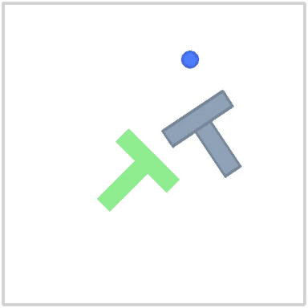
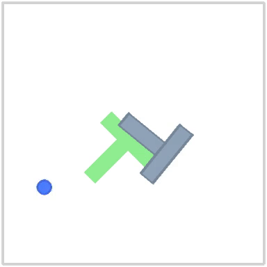

# ACT on PushT：LeRobot 模仿学习复现

基于 **LeRobot v0.4.4**，在 WSL2 / Ubuntu 22.04 与 RTX 4060 Laptop 8 GB 上完成 ACT 的数据读取、训练、断点续训、仿真评测与 GIF 展示。

主要结果：累计训练 50,000 步，执行间隔 `n\_action\_steps=10`，在 seed=42 起始的一次 50 回合评测中成功 11 次，成功率 22%。这是一次模型训练和一次评测序列的结果，未完成多训练种子统计，不代表官方论文性能或稳定泛化能力。首次 5 回合得到的 40% 不是本项目的主要性能结论。

这是官方算法的入门复现与实验记录，未提出新算法，未进行真实机器人部署。

## 演示

| 成功案例（seed=44） | 失败案例（seed=42） |
| --- | --- |
|  |  |

两份 GIF 文件对应分别进行的单回合评测，模型、执行间隔相同。两份 GIF 已从原始 MP4 重新导出：成功案例 245 帧、24.5 秒；失败案例 300 帧、30 秒。成功标记分别为 100% 与 0%，不是根据肉眼相似程度推断。这是挑选的案例；总体结果请看 50 回合评测。

任务：控制蓝点推动灰色 T 块，使它与绿色目标对齐。默认环境以几何面积重合率大于 95% 判断成功，接近目标不一定成功；没有额外要求“成功后稳定保持若干秒”。GIF 不是原始训练示范。

## 方法与数据

* 工具：[LeRobot](https://github.com/huggingface/lerobot/tree/v0.4.4)。
* 算法：[ACT / ALOHA](https://tonyzhaozh.github.io/aloha/)，Action Chunking with Transformers。
* 数据：[lerobot/pusht](https://huggingface.co/datasets/lerobot/pusht)，元信息 `codebase\_version=v3.0`。
* 数据包含 206 条示范、25,650 个时间步、10 Hz、96×96 RGB 图像。
* 输入：`observation.image` 与 `observation.state`（蓝点二维位置）；输出：后续一段二维动作目标。
* `chunk\_size=100`。评测时每次执行 10 或 100 步后重新预测；10 步约为 1 秒仿真时间。
* 采用固定数据集的离线模仿学习：比较预测与示范动作以更新参数。评测中不更新权重，也不使用奖励在线学习。

## 已完成实验

训练均使用 batch size 4、seed 42、PyAV 后端。50k 模型从 10k 检查点恢复模型及优化器状态，继续更新 40k 步。

|累计训练步数|每次执行动作数|评测回合|平均累计奖励|平均最高奖励|成功率|
|-:|-:|-:|-:|-:|-:|
|200|100|5|11.2567|0.0967|0/5（0%）|
|10,000|100|5|26.2330|0.3470|0/5（0%）|
|10,000|10|5|25.7560|0.3980|0/5（0%）|
|50,000|10|5|142.1024|0.8905|2/5（40%）|
|**50,000**|**10**|**50**|**88.6320**|**0.6350**|**11/50（22%）**|

* 减少执行间隔的 5 回合实验中，平均最高奖励提高，但累计奖励略降、成功率未提升，不能断言整体更优。
* 在相同执行间隔的 5 回合实验中，增加训练量后表现改善；仍不足以分离所有失败原因。
* 平均最高奖励是环境评分，不应直接称为“平均重合率”。
* 50 回合原评测只保存前 10 段视频，汇总 JSON 未含逐回合成功标记。因此另用 seed=42…46 分别单回合评测，确认 GIF 的成败。
* 不同种子/硬件/依赖可能产生差异；本项目未报告统计置信区间。

`results/reported\_metrics.csv` 与 `results/reported\_metrics.json` 是从实验者在会话中提供的运行日志转录的结果，**不是助手重新运行的结果**。原机采集已完成：30 项，缺失 0 项，错误 0 项；原始记录见 evidence/，转录指标见 results/。

## 环境

|项目|已验证配置|
|-|-|
|系统|Windows + WSL2 / Ubuntu 22.04|
|CPU / 内存|AMD Ryzen 9 7945HX / 16 GB|
|GPU|RTX 4060 Laptop，8 GB VRAM|
|Windows NVIDIA 驱动|566.26|
|Python|3.10.12|
|PyTorch / torchvision|2.6.0+cu124 / 安装指定 0.21.0|
|LeRobot|v0.4.4；精确 commit 待从原机采集|
|TorchCodec / datasets / fsspec|0.2.1 / 4.8.5 / 2026.2.0|
|视频读取|PyAV；FFmpeg 已安装，实际版本待采集|

`requirements-observed.txt` 仅列已知版本，不是完整依赖锁。`scripts/collect\_local.sh` 将在原机导出实际 `pip freeze` 和 commit。最初克隆 main 时的 commit 不能当作 v0.4.4 的 commit。

## 安装（新机器使用；现有环境无需重装）

在 WSL Ubuntu 终端执行。先检查 `nvidia-smi`，确认 GPU 可用。本项目路径与已有比赛项目分开。

```bash
sudo apt update
sudo apt install -y git python3-pip python3-venv ffmpeg
mkdir -p \~/projects
cd \~/projects
git clone https://github.com/huggingface/lerobot.git
cd lerobot
git switch --detach v0.4.4
python3 -m venv .venv
source .venv/bin/activate
python -m pip install --upgrade pip setuptools wheel
python -m pip install torch==2.6.0 torchvision==0.21.0 --index-url https://download.pytorch.org/whl/cu124
python -m pip install -e '.\[pusht]' torch==2.6.0 torchvision==0.21.0 torchcodec==0.2.1
python -m pip check
python -c "import torch; print(torch.\_\_version\_\_); print(torch.cuda.is\_available())"
```

后续依赖可能更新；以上是本次成功安装流程，不保证未来解析出完全相同的依赖。新环境出现问题时，应参考采集后的实际版本记录，不要盲目升级 PyTorch。

## 现有电脑：进入环境与运行

在 Windows PowerShell 运行：

```powershell
wsl -d Ubuntu-22.04
```

进入 Ubuntu 后：

```bash
cd \~/projects/lerobot
source .venv/bin/activate
```

假设成果仓库位于 `\~/projects/act-pusht-reproduction`，运行下列脚本。脚本通过 `LEROBOT\_DIR` 定位官方代码，默认 `\~/projects/lerobot`。模型和大部分运行输出仍存于官方代码目录的 `outputs/` 中。

```bash
# 新机器/重新训练时才运行，现有模型无需重跑：
bash \~/projects/act-pusht-reproduction/scripts/train\_10k.sh
bash \~/projects/act-pusht-reproduction/scripts/resume\_50k.sh

# 当前最终模型：50 回合评测，执行间隔 10，seed 42
bash \~/projects/act-pusht-reproduction/scripts/evaluate.sh

# 单回合案例（seed 44 成功、seed 42 失败是本次已观测结果）
bash \~/projects/act-pusht-reproduction/scripts/evaluate.sh 44 1 10 outputs/eval/demo\_seed\_44
bash \~/projects/act-pusht-reproduction/scripts/evaluate.sh 42 1 10 outputs/eval/demo\_seed\_42

# 从已有案例视频生成 GIF（已存在的 GIF 不覆盖）
bash \~/projects/act-pusht-reproduction/scripts/make\_gifs.sh
```

脚本默认输出沿用已完成实验路径，**已存在的输出目录会明确停止，避免覆盖**。若要重复实验，请使用新的输出目录；`evaluate.sh` 第四个参数可指定新目录。其它训练脚本可通过 `RUN\_OUTPUT\_DIR` 变量指定新目录。续训来源可通过 `RESUME\_CONFIG` 指定。

模型权重约 198 MB，训练状态约 394 MB/检查点，不纳入本成果仓库。当前没有公开权重下载链接；复现者需自己训练或另外取得本机模型文件。不能只下载 GIF 就运行策略。

## 原电脑补齐原始证据

在已激活原 LeRobot 环境的 Ubuntu 中运行：

```bash
bash \~/projects/act-pusht-reproduction/scripts/collect\_local.sh
```

脚本复制已有评测 `eval\_info.json`、模型/训练配置；记录实际依赖版本、官方代码 commit 和权重 SHA256。不复制模型权重、数据集、凭据或代理设置，不修改官方代码。找不到的文件写入采集清单。请检查 `evidence/collection\_manifest.json`。

## 已解决的问题

1. main 要求 Python ≥3.12，与本机 3.10 不匹配：固定 LeRobot v0.4.4。
2. Ubuntu 访问 Hugging Face 超时，而 Windows 浏览器可访问：临时配置 Windows 代理；具体见 `docs/OPERATIONS.md`。不把个人网络配置写入仓库。
3. TorchCodec 0.2.1 不接受 LeRobot 传入的 `LocalFileOpener`：数据读取和训练显式使用 `video\_backend=pyav`；不改已验证的 GPU 环境。
4. 续训进度条为 `0/40000`，但累计步数从 10k 继续：进度条统计本次新增更新次数，不能据此判定从零训练。

## 局限与下一步

* 主要评测仅一次 50 回合，成功率 22%，仍有大量失败；没有达到稳定控制。
* 示范偏离、接触时机、朝向对齐、训练量等都是可能因素，尚未建立完整因果分析。
* 未验证真实机械臂、ROS2、MoveIt 或 Sim2Real；当前不接收中文指令，不是 VLA 模型复现。
* 下一步可固定评测条件比较中间检查点、执行间隔，记录单回合重合率，增加训练种子；不修改成功阈值来提高成绩。

## 工作来源与个人贡献边界

本人在自己的电脑上执行了环境安装、数据检查、训练、续训、评测与视频查看，反馈日志，并学习 ACT 和实验指标。命令、排错建议及本仓库整理由 AI 辅助。尚不宣称独立实现 ACT、独立设计新算法或完成实机部署。这是一次关于计算机学习领域的概念、实践操作，以及领域相关的网络生态的初步学习与探索。

## 目录

* `media/`：已生成的成功与失败动画。
* `scripts/`：训练、评测、采集和 GIF 转换脚本。
* `results/`：会话日志转录的指标及单回合结果。
* `docs/OPERATIONS.md`：从下载 ZIP 到建立 Git 仓库的操作指南。
* `requirements-observed.txt`：已知依赖，不是完整锁文件。
* `evidence/`：已包含原机采集的评测、配置和环境记录。

上游代码、数据集和算法归原作者所有；使用时查看相应许可证。本仓库不包含官方代码副本。

