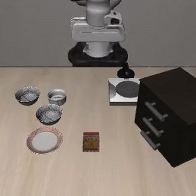

# ACT：LIBERO 单任务训练与评测

使用 LeRobot v0.4.4 的 ACT 实现，训练机械臂将指定黑碗放到盘子上的策略。
本项目使用现有算法，完成数据筛选、训练验证划分、归一化、
训练与仿真评测，未提出新的 ACT 算法。

## 结果

| 项目 | 结果 |
|---|---:|
| 完整示范 | 45 条：36 条训练、9 条验证 |
| 训练／验证时间步 | 3573／914 |
| 训练更新次数 | 10,000 |
| 验证集首步动作 MAE：100 步模型 | 0.7789 |
| 验证集首步动作 MAE：10k 模型 | 0.4596 |
| 单任务仿真评测 | **48/50 成功，96%** |

验证 MAE 在归一化动作尺度上计算；仿真评测使用 seed=42。
该结果仅覆盖 Spatial 套件任务 0，不代表整个套件的成功率。

## 演示

[查看完整 MP4](media/success.mp4)

## 数据与配置

- 数据集：lerobot/libero。
- 数据集任务编号：34，对应仿真 libero_spatial 的任务 0。
- 输入：两路 256×256 RGB 图像、8 维机械臂状态。
- 输出：7 维相对控制动作。
- 动作块长度：50；每执行 10 步重新预测。
- batch_size=2，学习率 1e-5，使用 AdamW。
- 状态和动作统计量仅从训练示范计算。
- 图像使用固定的 ImageNet 均值和标准差。
- 在本地 RTX 4060 Laptop 8GB 上训练。

## 文件与证据

- [训练／验证划分及数据版本](config/libero_task34_split.json)
- [训练集归一化统计量](config/libero_task34_train_stats.json)
- [验证误差比较](results/validation.csv)
- [50 回合评测摘要](results/eval50_summary.json)
- [原始逐回合评测记录](results/eval50_raw.json)
- [训练及评测脚本](scripts/)

## 使用说明

这里的 scripts 是在 LeRobot 源码目录运行的脚本副本，
不是独立安装的软件包。

复现时，将 scripts 中的脚本及 config 中的两个 JSON
复制到已配置好的 LeRobot v0.4.4 根目录，在该目录运行。
准备数据时应使用划分文件记录的数据集版本。

训练完成后，需将验证、评测脚本中的模型路径改成自己的输出目录。
当前保留的是本次实验路径。

模型权重、优化器状态和训练数据不随本目录发布。

## 局限

- 当前只训练和评测一个任务。
- 仅使用一个评测种子。
- 尚未分析两次失败的具体原因。
- 不同划分中的示范可能具有相似场景，不能据此声称跨场景泛化。
- 项目使用 AI 辅助脚本编写和排错；训练与评测由本人实际运行。
